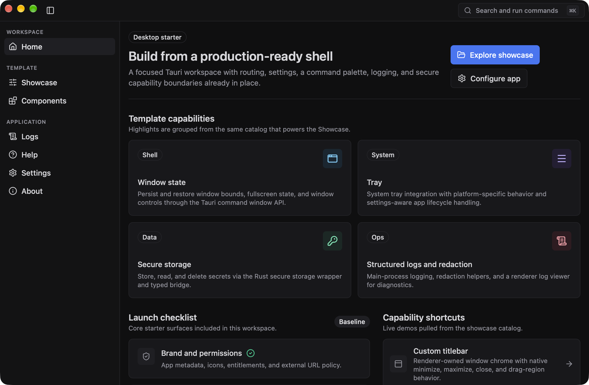
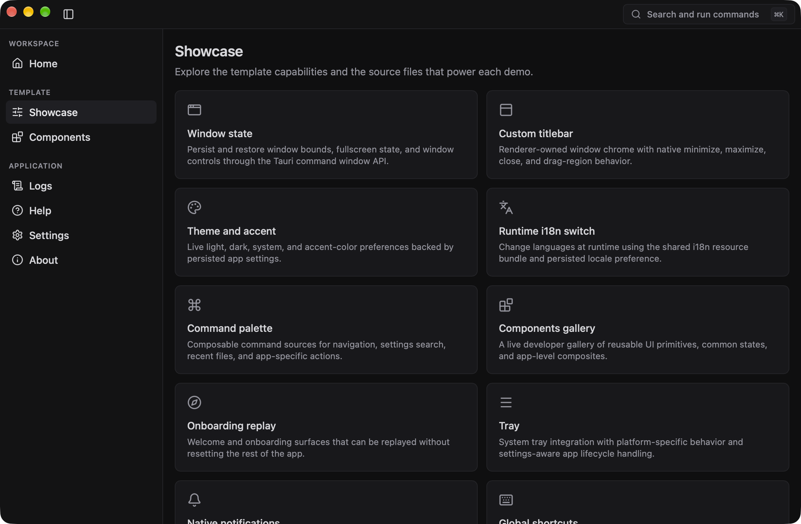
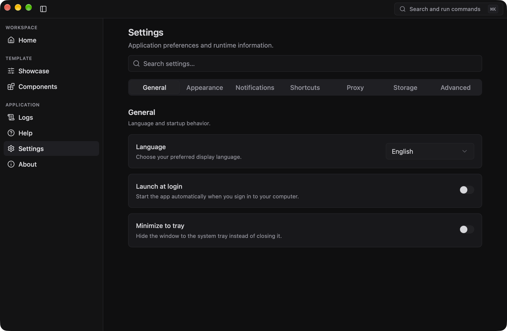

# Tauri Starter

An open-source Tauri 2 + React desktop app starter that already feels like a finished app: type-safe Rust commands, a
system tray, deep links, a searchable settings center, a command palette, onboarding, theming, and i18n. Clone it, run
it, and replace the demo pages with your product.

[](https://github.com/soarstarter/tauri-starter/actions/workflows/ci.yml)
[](LICENSE)


<p align="center">
  
</p>

It runs fully locally: no account, no backend, no `.env` file, and the app itself sends no network requests.

<table>
  <tr>
    <td></td>
    <td></td>
  </tr>
  <tr>
    <td align="center">Showcase capability catalog</td>
    <td align="center">Settings center with search</td>
  </tr>
</table>

Prefer Electron? [Electron Starter](https://github.com/soarstarter/electron-starter) is the same app built on Electron.

## Features

**Desktop platform**

- Single-instance app with app intents: a second launch, a `--route=` flag, or a deep link focuses the running window
  and navigates it.
- `tauri-starter://` deep links, validated against a fixed route list.
- System tray with light, dark, and macOS template icons that follow the OS theme.
- Native application menu, localized and rebuilt when the language changes.
- Window size, position, and zoom level persisted across launches.
- Native notifications that respect the user's setting.
- Shortcut registry for in-window and OS-wide global shortcuts, with per-user overrides; launch at login.
- File dialogs with a recent-files list.

**Type-safe IPC**

- Native code is plain Rust `#[tauri::command]` functions. [`tauri-specta`](https://github.com/specta-rs/tauri-specta)
  generates their TypeScript types into `src/lib/bindings.ts`, so there is no hand-written schema to keep in sync.
- CI regenerates the bindings and fails if the committed file drifts from the Rust source.
- Per-domain wrappers in `src/lib/tauri/`, a `useTauri()` hook, and a typed event helper.

**Security**

- Tauri capabilities grant each plugin only the permissions the app uses; nothing is allowed by wildcard.
- A content security policy that allows no external origins.
- An external-URL policy that only opens `https:` and `mailto:` links, enforced in TypeScript, in the Rust command, and
  in the opener capability.
- Log redaction for tokens, secrets, and credentials in URLs.
- Secure storage backed by the OS keychain through the `keyring` crate, keyed by a fixed list of names.

**App shell**

- Custom titlebar, collapsible sidebar layout, lazy-loaded routes, and a themed error fallback.
- Settings center with tabs and search: general, appearance, notifications, shortcuts, proxy, storage, and advanced.
- Command palette (`Cmd/Ctrl+K`) over routes, settings, Showcase demos, and recent files.
- First-run onboarding with an optional EULA gate.
- Light, dark, and system themes with accent colors.
- English and Chinese, switchable at runtime, including the native menu and tray.
- About (with copyable, redacted diagnostics), Logs, Help, and offline banner.

**Data on the device**

- Versioned settings store with forward migrations.
- Settings backup export and import that never includes secrets.

**Showcase**

- A capability catalog with live demos for the features above, plus a gallery of the bundled shadcn/ui components.
- Everything demo-only is marked `[template-demo]` and can be removed with [docs/CUSTOMIZE.md](docs/CUSTOMIZE.md).

**Quality**

- Vitest unit tests for settings, intents, IPC wrappers, and UI; Rust unit tests for commands.
- ESLint, Prettier, `tsc`, `cargo fmt`, and `cargo clippy` in a CI workflow that also compiles a release build on
  Windows, macOS, and Linux.

## Quick start

1. Install the Rust toolchain and your platform's system dependencies (Xcode Command Line Tools on macOS, the MSVC build
   tools and WebView2 on Windows, `webkit2gtk-4.1` and friends on Linux) by following the
   [Tauri prerequisites guide](https://tauri.app/start/prerequisites/).
2. Install Node.js `^20.19.0 || >=22.12.0` and pnpm 11.
3. Clone and run:

   ```bash
   git clone https://github.com/soarstarter/tauri-starter.git
   cd tauri-starter
   pnpm install && pnpm dev
   ```

The first `pnpm dev` compiles the Rust shell and takes a few minutes; later runs are incremental. No configuration is
needed. [`.env.example`](.env.example) lists the two optional settings: the Showcase switch and the repository URL used
by the Help page.

## Lite and Pro

This repository is the free, MIT-licensed edition. Everything that needs a backend or a release pipeline lives in
[SoarStarter Pro](https://soarstarter.com/tauri?utm_source=github&utm_campaign=tauri-lite).

|                                                                              | Tauri Starter (this repo) | SoarStarter Pro |
| ---------------------------------------------------------------------------- | :-----------------------: | :-------------: |
| Desktop platform: tray, deep links, menus, window state, notifications       |            ✅             |       ✅        |
| Type-safe Rust commands with generated TypeScript bindings                   |            ✅             |       ✅        |
| Security hardening: capabilities, CSP, external-URL policy, keychain storage |            ✅             |       ✅        |
| Settings center, command palette, onboarding, theming, i18n                  |            ✅             |       ✅        |
| Showcase and components gallery                                              |            ✅             |       ✅        |
| Unsigned local builds for Windows, macOS, and Linux                          |            ✅             |       ✅        |
| Email sign-in, profiles, and avatars (Supabase)                              |                           |       ✅        |
| Unified backend that shares accounts and data with the SoarStarter web app   |                           |       ✅        |
| Checkout, subscriptions, license keys, and feature gates (Creem)             |                           |       ✅        |
| Auto-updates from a self-hosted update feed                                  |                           |       ✅        |
| Code signing, notarization, and a tagged release workflow                    |                           |       ✅        |
| Opt-in error reporting (Sentry) and product analytics slots                  |                           |       ✅        |
| WebDriver smoke tests and a one-command rebrand script                       |                           |       ✅        |

## Scripts

| Command                             | What it does                                                       |
| ----------------------------------- | ------------------------------------------------------------------ |
| `pnpm dev`                          | Start the Tauri app with Vite hot reload                           |
| `pnpm dev:web`                      | Start only the Vite frontend in a browser (native APIs are absent) |
| `pnpm build`                        | Build unsigned installers for the current platform                 |
| `pnpm lint:check` / `pnpm lint`     | Lint (`lint` also fixes)                                           |
| `pnpm format:check` / `pnpm format` | Check or apply Prettier formatting                                 |
| `pnpm typecheck`                    | Type-check the frontend                                            |
| `pnpm test` / `pnpm test:unit`      | Run the core unit tests / all frontend unit tests (as CI does)     |
| `cargo test` (in `src-tauri/`)      | Run the Rust tests and regenerate `src/lib/bindings.ts`            |
| `pnpm tauri build --no-bundle`      | Compile a release binary without packaging, as CI does             |

`pnpm build` produces an NSIS installer and an MSI on Windows, a DMG on macOS 11 or later, and AppImage, deb, and rpm
packages on Linux. None of them carry a developer certificate. The macOS app gets an ad-hoc signature
(`bundle.macOS.signingIdentity: "-"`) so it runs on the machine that built it, but macOS Gatekeeper and Windows
SmartScreen will still warn when you open the installers on another machine.

## Project structure

```text
src/                   Frontend: React routes, components, hooks, locales, styles
  lib/tauri/           Typed wrappers over the generated command bindings, plus events and external links
  lib/bindings.ts      Generated by tauri-specta from the Rust commands; do not edit
  lib/settings/        Settings store, migrations, and backup
  lib/menu/, lib/tray/ Native menu and tray, built from TypeScript
  lib/intents/         Deep links, argv intents, and the route whitelist
  showcase/            [template-demo] capability catalog
  routes/showcase/     [template-demo] Showcase pages, demos, and components gallery
src-tauri/             Rust shell: commands/, capabilities/, tauri.conf.json, app icons
shared/                Brand constants and config flags
resources/build/       Tray icons
```

Path aliases: `@/` for `src/` and `@/shared` for `shared/`.

## Add a native command

1. Write the command in a module under `src-tauri/src/commands/`:

   ```rust
   #[tauri::command]
   #[specta::specta]
   pub fn greet(name: String) -> String {
       format!("Hello, {name}")
   }
   ```

2. Register it in the `collect_commands![…]` list in `src-tauri/src/lib.rs`.
3. Run `cargo test --manifest-path src-tauri/Cargo.toml` (or just `pnpm dev`) to regenerate `src/lib/bindings.ts`, and
   commit the updated file.
4. If the command needs a plugin permission, add the narrowest one to `src-tauri/capabilities/default.json`; see
   [docs/CAPABILITIES.md](docs/CAPABILITIES.md).
5. Call it from React through the generated, fully typed `commands` object, or wrap it in a `src/lib/tauri/` module:

   ```tsx
   import { commands } from '@/lib/bindings'

   const message = await commands.greet('Ada')
   ```

## Deep links

The app registers the `tauri-starter://` scheme:

```bash
open 'tauri-starter://settings'      # macOS
xdg-open 'tauri-starter://settings'  # Linux
start tauri-starter://settings       # Windows
```

On macOS the scheme comes from the app bundle, so test it with a built app. On Windows and Linux, `pnpm dev` registers
it at startup. Routes are limited to the list in `src/lib/intents/routes.ts`; anything else is ignored.

## Make it yours

- Brand: edit `shared/constants.ts`, then the matching fields in `src-tauri/tauri.conf.json`, `src-tauri/Cargo.toml`,
  and `package.json`, and replace the icons. The full list is in [docs/CUSTOMIZE.md](docs/CUSTOMIZE.md).
- Showcase: set `VITE_SHOWCASE_ENABLED=false` to preview the app without it, then follow
  [docs/CUSTOMIZE.md](docs/CUSTOMIZE.md) to delete it.
- Going further: the
  [SoarStarter Pro documentation](https://soarstarter.com/docs/tauri?utm_source=github&utm_campaign=tauri-lite) covers
  the full template. Its pages on the desktop shell, commands, settings, and Showcase also apply here; sign-in, billing,
  auto-update, and release signing are Pro only.

## Contributing and security

Bug fixes and small improvements are welcome; see [CONTRIBUTING.md](CONTRIBUTING.md). To report a vulnerability, follow
[SECURITY.md](SECURITY.md) instead of opening a public issue.

## License

Tauri Starter is released under the [MIT License](LICENSE). You can use, modify, and distribute it, including in
commercial and closed-source apps, as long as the copyright and license notice in [LICENSE](LICENSE) is included in all
copies or substantial portions of it.

Third-party libraries keep their own licenses; the main ones are listed in [CREDITS.md](CREDITS.md).
